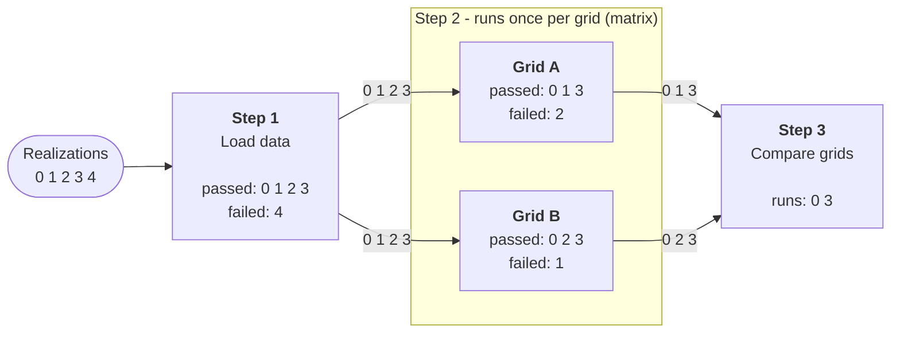
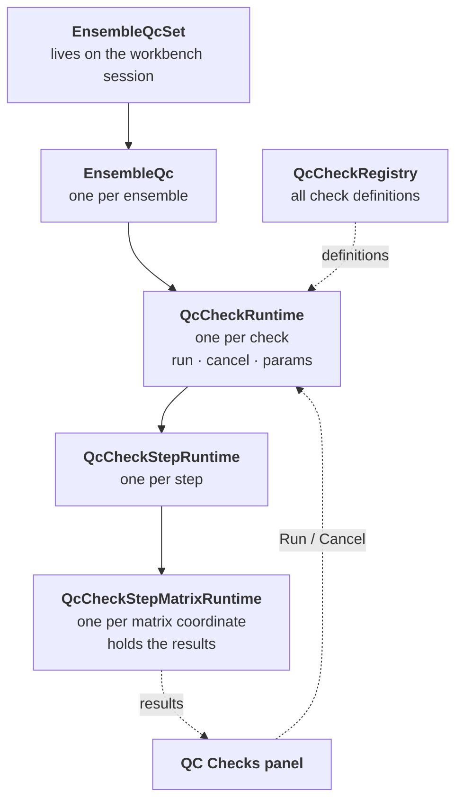

# QC framework

Runs quality-control checks on each ensemble, realization by realization, and shows the results in the **QC Checks**
panel in the right sidebar.

## The idea

A **check** is a list of **steps** that run one after another. Each step looks at every realization it gets and marks
it as passed or failed. **Only realizations that passed move on to the next step.**

A step can also run **once per item** - for example once per grid. This is called a **matrix**: each item (a _matrix
coordinate_) gets its own run and its own row of results.

### Example

An ensemble with realizations 0-4, and a check with three steps:



1. **Step 1** runs all realizations. Realization 4 fails, so it stops there.
2. **Step 2** runs once for grid A and once for grid B, each with realizations 0-3. Each grid has its own results.
3. **Step 3** runs once, so it only gets realizations that passed for **every** grid: 0 and 3.

If two steps in a row both run per grid, grid A of the second step continues from grid A of the first step, and so on.

## How the pieces connect



- When ensembles are added or removed, `EnsembleQcSet` adds or removes the matching `EnsembleQc`.
- A step that doesn't run per item still has exactly one `QcCheckStepMatrixRuntime`.

## Adding a check

A step reports one result per realization: `success`, `failure` (ran, but didn't pass) or `exception` (couldn't be
checked).

```ts
const MyStep: QcCheckStepDefinition<{ mean: number }, { gridNames: string[] }> = {
    name: "Check mean value",
    // Optional - run once per selected grid
    matrixCoordinates: (params) => params.gridNames.map((name) => ({ key: name, label: name })),
    async run(context) {
        for (const realization of context.realizations) {
            const mean = await context.fetchQuery(/* query options for this realization */);
            context.reportRealizationResult(
                realization,
                mean < 1000
                    ? { kind: "success", metrics: { mean } }
                    : { kind: "failure", metrics: { mean }, reason: "Mean is too high" },
            );
        }
    },
};

export const MyCheck: QcCheckDefinition<{ gridNames: string[] }> = {
    name: "My check",
    defaultParams: { gridNames: [] },
    steps: [MyStep],
};
```

Register it in `registerAllQcChecks.ts`:

```ts
QcCheckRegistry.registerCheck("my-check", MyCheck);
```

What a step gets in `context`:

- `realizations` - the realizations to check (those that passed the previous step).
- `params` - the check's settings, shared by all its steps.
- `matrixCoordinate` - the current item, if the step runs per item.
- `previousStepResults` - the previous step's results for these realizations.
- `fetchQuery` - use this for requests, so they are cancelled when the user clicks Cancel.

## Good to know

- If a step throws, the realizations it hadn't reported yet are marked as `exception`.
- QC state is not saved with the session yet.
- Selecting a realization should set the dashboard's realization elevated setting - a no-op until the elevated
  settings framework is in place.
- `checks/DummyRandomCheck.ts` is a temporary check for trying out the panel.
- Tests: `frontend/tests/unit/QcCheckRuntime.test.ts` and `EnsembleQcSet.test.ts`.
